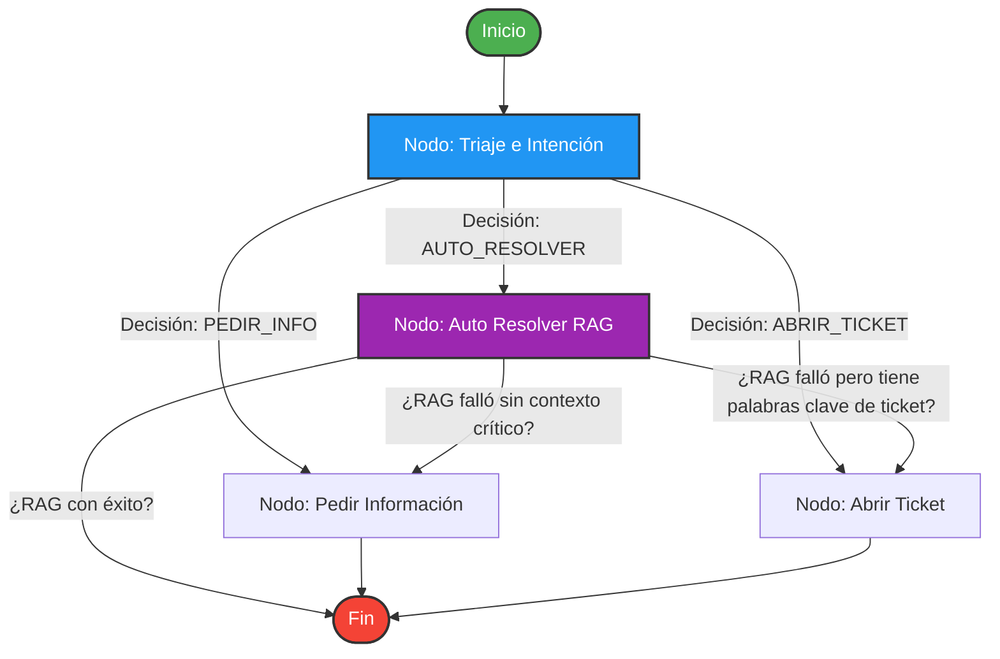
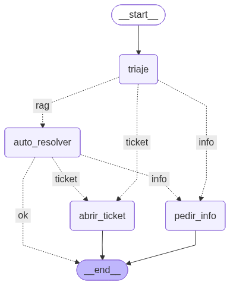

# 🤖 Agente Inteligente de Soporte: Triaje & RAG con LangGraph

Sistema de soporte técnico y de RRHH de última generación diseñado para automatizar la gestión de tickets internos. Combina la orquestación de estados de **LangGraph**, la recuperación de información de **LangChain**, y la velocidad de **Gemini 2.5 Flash** para clasificar solicitudes, auto-resolver dudas y escalar casos complejos.

A diferencia de un chatbot tradicional, este agente toma decisiones autónomas, es capaz de analizar solicitudes de usuarios internos, clasificarlas de forma inteligente basadas en la urgencia e intención del usuario, y decidir si auto-resolver mediante un motor RAG (Retrieval-Augmented Generation), o solicitar más detalles o escalar el caso abriendo un ticket, lo que permite optimizar el tiempo de respuesta del equipo de soporte.

# 📐 Arquitectura y Flujo de Trabajo

El agente utiliza un flujo de trabajo de estados gestionado con **LangGraph**. Dependiendo de la intención detectada y el éxito del motor de búsqueda (RAG), el agente transiciona dinámicamente entre estados:



## 🖼️ Diagrama del Flujo del Agente



## Componentes Clave

* **Agente de Triaje Estructurado**: Utiliza la capacidad de salida estructurada de Gemini con Pydantic `(with_structured_output)` para garantizar que la clasificación siempre retorne un JSON válido y estricto con los campos `decision` y `urgencia`. Cero alucinaciones en el enrutamiento.

* **Motor RAG Dinámico**: Busca coincidencias semánticas en la base de datos vectorial local basada en **FAISS** indexada con documentos internos en PDF (políticas de home office, viajes, etc.).

* **Lógica de Transición (Aristas Condicionales)**: Si la consulta no es clara o el motor RAG no encuentra una respuesta de alta confianza, el agente redirige el estado de manera automática, garantizando una experiencia de usuario fluida.

* **Memoria de Estado:** Implementación de `StateGraph` para mantener el contexto de la conversación a lo largo de los nodos.

📂 Estructura del Proyecto

```txt
├── Docs/                          # Carpeta para colocar los PDFs de políticas internas\
├── RAG_optimizado_2026.py         # Script principal con la lógica del agente y LangGraph\
├── requirements.txt               # Archivo de dependencias del proyecto\
├── .env.example                   # Plantilla de variables de entorno para las credenciales\
└── README.md                      # Documentación del proyecto
```
----------------

## 🚀 Requisitos e Instalación Local

Si vas a ejecutar el proyecto de forma local en tu computadora, sigue estos pasos:

### 1. Clonar el repositorio y configurar entorno

```bash
git clone [https://github.com/Haruki-24/AI_Agent_RAG_LangGraph.git](https://github.com/Haruki-24/AI_Agent_RAG_LangGraph.git)

cd AI_Agent_RAG_LangGraph

# Crear y activar entorno virtual
python -m venv venv

# Activar entorno:
- En Windows: venv\Scripts\activate
- En macOS/Linux: source venv/bin/activate

# Instalar dependencias
pip install -r requirements.txt

```

### 2. Configurar las variables de entorno (.env)

Duplica el archivo de plantilla .env.example y renómbralo a .env:

```bash
cp .env.example .env
```

Abre tu archivo .env y añade tu clave:

```bash
GEMINI_API_KEY="tu-api-key-de-gemini-aqui"
```

### 3. Ejecutar el script

```bash
python RAG_optimizado_2026.py
```

## 📓 Alternativa: Ejecución en Google Colab

Si prefieres ejecutar y experimentar este agente en la nube utilizando Google Colab, no necesitas lidiar con archivos .env. Sigue estas sencillas instrucciones dentro de tu notebook:

### 1. Crea un Notebook en Google Colab

* Abre el siguiente enlace: [https://colab.research.google.com/](https://colab.research.google.com)
* Seleccióna crear **Nuevo notebook**, e inicia sesion con tu cuenta de goolge.

### 2. Instalar las dependencias

Crea una celda de código en Colab y ejecuta el siguiente comando para instalar todos los paquetes requeridos directamente de tu repositorio:

```python
!pip install -r https://raw.githubusercontent.com/Haruki-24/AI_Agent_RAG_LangGraph/main/requirements.txt
```

### 3. Configurar la API Key de forma segura

Google Colab proporciona un panel para almacenar claves privadas llamado Secrets (icono de llave 🔑 en el menú de la izquierda).

* Abre el panel de Secrets (icono 🔑).

* Añade un nuevo secreto con el nombre: Gemini-GC.

* Pega tu API Key de Gemini en el valor.

* Asegúrate de activar la casilla de "Notebook access" (Acceso del cuaderno) para ese secreto.

### 4. Preparar el entorno y ejecutar el Agente

Para ejecutar el archivo .py en Colab sin necesidad de editar el código que busca el entorno local, agrega esta celda inicial para mapear la clave del secreto de Colab directamente a la variable de entorno del sistema:

```python
import os
from google.colab import userdata

# - Mapeamos el secreto 'Api-key-gemini' de Colab a la variable que busca nuestro script
os.environ["GEMINI_API_KEY"] = userdata.get('Api-key-gemini')

# - (Opcional) Si necesitas cargar documentos desde tu Google Drive, móntalo aquí:
from google.colab import drive
drive.mount('/content/drive')

# - Ejecutamos el script principal
!python RAG_optimizado_2026.py

```

## 📈 Demostración de Resultados en Consola

```txt
*PREGUNTA*: ¿Puedo solicitar mi reembolso por usar mi internet en home office?
Ejecutando nodo 'triaje'...
Ejecutando arista 'decision_triaje'...
Ejecutando nodo 'auto_resolver'...
Ejecutando arista 'decision_rag'...
RAG con éxito, finalizando flujo

*DECISION TRIAJE*: AUTO_RESOLVER | URGENCIA: BAJA\
*ACCIÓN FINAL DEL AGENTE*: AUTO_RESOLVER\
*RESPUESTA FINAL*: Sí, puedes solicitar un reembolso del 50% de tu factura de internet según la política de Home Office.
  - *CITACION 1*: politica_home_office.pdf -> Reembolso del 50% aplicable...

```

## 📘 Documentación y Arquitectura (Para Desarrolladores)

Este proyecto está diseñado no solo para ejecutarse, sino para ser **reutilizado y escalado**.

He documentado a fondo las decisiones arquitectónicas, el flujo de estado (`AgentState`), y las instrucciones para modificar o extender el agente (como añadir nuevos nodos o cambiar el LLM).

👉 **[Haz clic aquí para leer el Glosario Técnico y Guía de Arquitectura (`glosario_codigo.md`)](./glosario_codigo.md)**

**¿Por qué es útil esta guía?**

* **Onboarding rápido:** Permite a cualquier desarrollador entender el código en minutos.
* **Escalabilidad:** Incluye instrucciones paso a paso para añadir nuevos nodos al grafo de LangGraph.
* **Buenas prácticas:** Explica la importancia de `Pydantic` y `with_structured_output` para evitar alucinaciones.

# 🛠️ Tecnologías Utilizadas

- **LangChain**: Abstracción y conectores de LLM.

- **LangGraph**: Orquestador de estados y flujos conversacionales complejos.

- **FAISS**: Almacenamiento vectorial eficiente en memoria local.

- **PyMuPDF**: Extracción rápida de texto de archivos PDF para la ingesta del RAG.

- **Pydantic V2**: Validación y tipado fuerte para las respuestas estructuradas del LLM.

- **Python-dotenv**: Carga automatizada de configuraciones locales desde el archivo .env.

Este proyecto fue desarrollado originalmente como parte de la formación *"Inteligencia de Datos y RAG Avanzado"* de *Alura Latam*, y luego refactorizado para implementar buenas prácticas de arquitectura de agentes.
